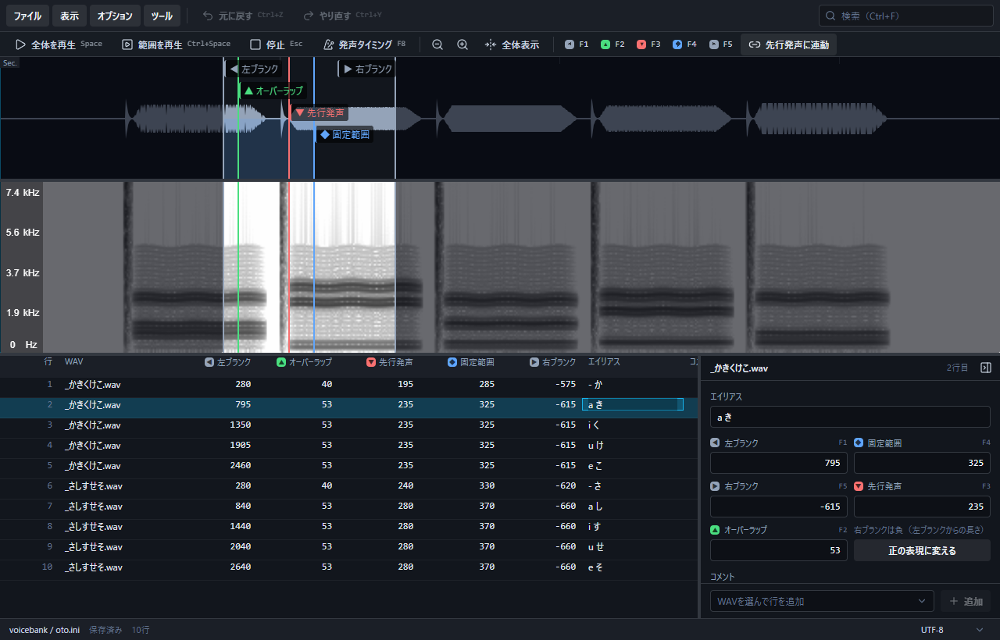
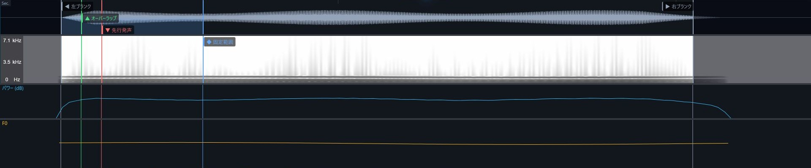
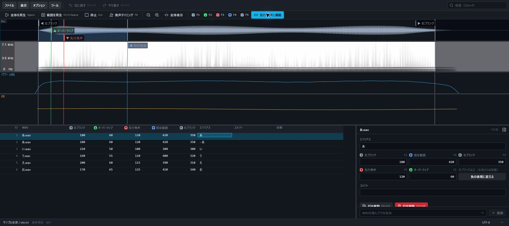
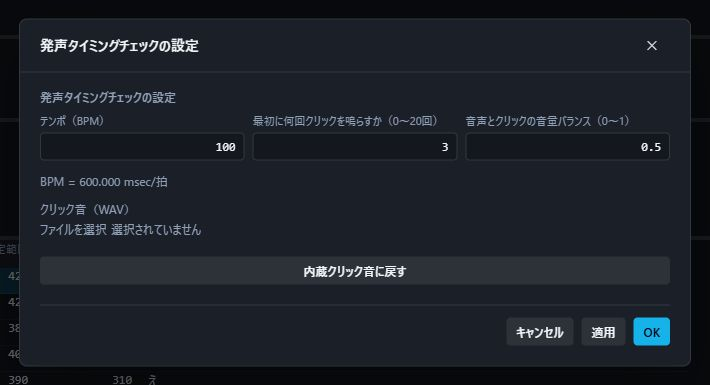
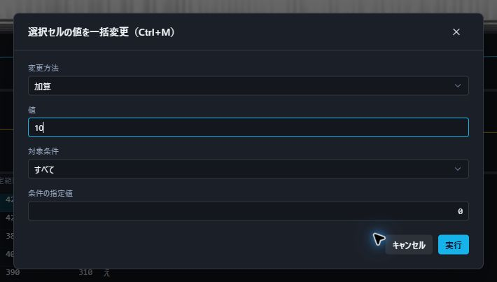
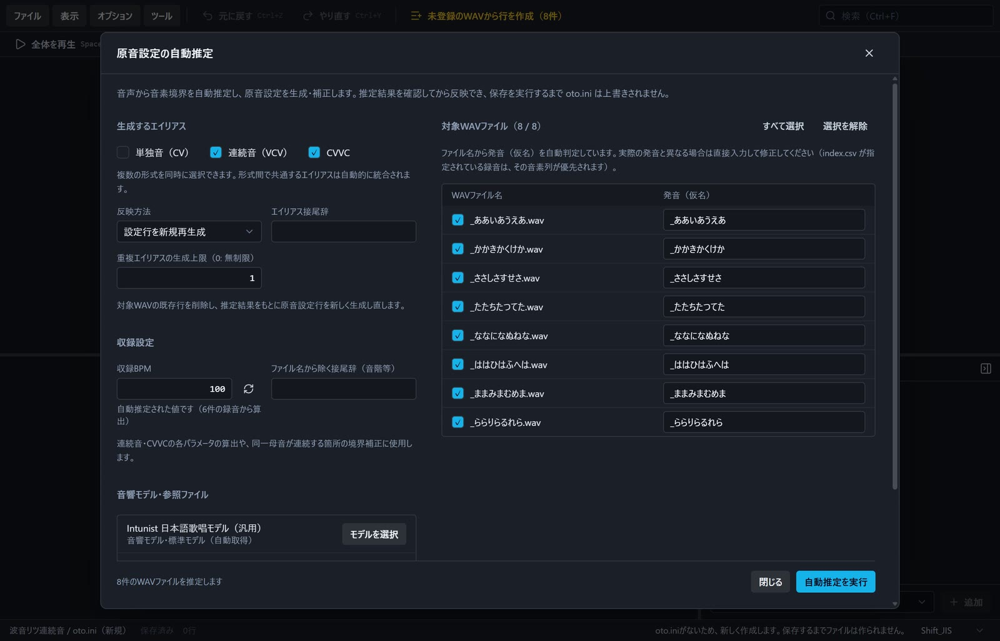
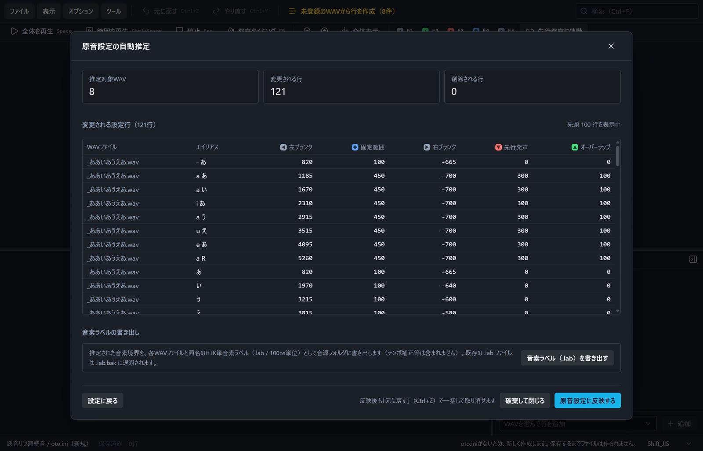

<div align="center">


# Avennota

**Webでもデスクトップでも快適に動く、現代的なUTAU原音設定エディター**

[](#対象環境)

</div>

Avennota（アヴェンノータ）は、UTAU音源の原音設定ファイル（`oto.ini`）を快適かつ安全に編集するためのオープンソースエディターです。

長年多くの音源制作者に愛用されてきた定番ツール **`setParam` をモデルに設計**されており、慣れ親しんだキー操作や作業の流れをそのまま引き継いで使用できます。インストール不要ですぐに使える **Webブラウザ版** と、オフラインでも軽快に動く **デスクトップ版** の両方を提供しています。



## 目次

- [ユーザー向けガイド（音源制作者の方へ）](#ユーザー向けガイド音源制作者の方へ)
  - [特徴](#特徴)
  - [ダウンロードと使い方](#ダウンロードと使い方)
    - [デスクトップ版（Windows・macOS・Linux）](#デスクトップ版windowsmacoslinux)
    - [Webブラウザ版](#webブラウザ版)
  - [基本的な編集手順](#基本的な編集手順)
  - [主な機能と画面紹介](#主な機能と画面紹介)
  - [主なショートカット早見表（setParam互換）](#主なショートカット早見表setparam互換)
  - [安心のファイル管理・安全機能](#安心のファイル管理安全機能)
- [開発者・貢献者向けガイド (for Developers)](#開発者貢献者向けガイド-for-developers)
  - [技術スタック](#技術スタック)
  - [環境構築とローカル実行](#環境構築とローカル実行)
  - [品質チェックとビルド](#品質チェックとビルド)
  - [設計資料・ドキュメント](#設計資料ドキュメント)
- [ライセンス](#ライセンス)

## ユーザー向けガイド（音源制作者の方へ）

### 特徴

- 🎹 **setParam を踏襲した操作感**
  - F1〜F5キーによるマーカー配置や、先行発声と左ブランクの連動移動など、`setParam` で培った感覚をそのまま活かして作業できます。
- 🌐 **Web・デスクトップの両対応**
  - PCにソフトを入れずブラウザ上でサッと作業したいときはWeb版、日常的にオフラインでじっくり作業したいときはデスクトップ版と、好みの環境を選べます。
- 📊 **見やすく高精度な音声解析パネル**
  - 波形表示だけでなく、スペクトログラム（周波数分布）、音量パワー、F0（基本周波数・ピッチ線）を自由に組み合わせて並べて確認できます。
- 🤖 **原音設定の自動推定（SHIRO）**
  - 音声から音素境界を推定し、単独音（CV）・連続音（VCV）・CVVCの原音設定をまとめて生成・補正できます。収録BPMも録音から自動で推定します。
- 🛡️ **既存の oto.ini を壊さない安全設計**
  - 未編集の行はバイナリデータをそのまま保持。文字コード（Shift_JIS / UTF-8）や改行形式を自動判別し、重複エイリアスやコメント行も勝手に消去・改変しません。
- 💾 **自動バックアップとクラッシュ復元**
  - 保存時に直前の状態を `oto.ini.bak` へ自動バックアップ。万が一のフリーズや誤終了時にも、編集途中の状態を自動復元できます。

### ダウンロードと使い方

#### デスクトップ版（Windows・macOS・Linux）

PCにインストールして使いたい方や、ネット環境を気にせず作業したい方におすすめです。

1. **[GitHub Releases](https://github.com/Lqm1/Avennota/releases/latest)** を開きます。
2. 「Assets」から、お使いのOSに合ったファイルをダウンロードします。ファイル名にバージョンとCPUの種類が含まれます。
3. 以下の手順でインストールまたは起動します。

| 環境 | ダウンロードするファイル | インストール・起動方法 |
| --- | --- | --- |
| Windows 11（x64） | `*_x64-setup.exe` | 実行し、インストーラーの案内に従います。インストール後はスタートメニューから起動します。 |
| Windows 11（ARM64） | `*_arm64-setup.exe` | 実行し、インストーラーの案内に従います。 |
| Windows 10（32bit・x86） | `*_x86-setup.exe` | 実行し、インストーラーの案内に従います。 |
| Windows（ポータブル） | `*_windows_x64-portable.exe`・`*_windows_arm64-portable.exe`・`*_windows_x86-portable.exe` | CPUに合うファイルを任意のフォルダに置き、そのまま実行します。 |
| macOS 14以降（Apple Silicon・Intel） | `*_universal.dmg` | DMGを開き、Avennotaを「アプリケーション」へドラッグして起動します。 |
| Linux（x64・Debian／Ubuntu） | `*_amd64.deb` | ダウンロード先で`sudo apt install ./ファイル名.deb`を実行し、アプリ一覧から起動します。 |
| Linux（ARM64・Debian／Ubuntu） | `*_arm64.deb` | `sudo apt install ./ファイル名.deb`でインストールします。 |
| Linux（32bit・Debian 12） | `*_i386.deb` | `sudo apt install ./ファイル名.deb`でインストールします。 |
| Linux（AppImage） | `*_amd64.AppImage`・`*_aarch64.AppImage`・`*_i386.AppImage` | CPUに合うファイルに`chmod +x ファイル名.AppImage`で実行権限を付け、`./ファイル名.AppImage`で起動します。 |

macOS用のappアーカイブも配布します。DMGの代わりにアーカイブを展開し、Avennota.appを「アプリケーション」へ移動して使えます。

> [!NOTE]
> Windows版はMicrosoft Edge WebView2 Runtimeを使います。インストーラーは不足時にRuntimeをダウンロードして導入します。ポータブル版は既存Runtimeを使い、不足時に導入方法を案内します。macOS版はシステムのWKWebView、Linux版はWebKitGTK 4.1を使います。

#### Webブラウザ版

ソフトをダウンロードせずに、今すぐ試したい場合におすすめです。

- **対応ブラウザ**: PC版 Google Chrome / Microsoft Edge（現行バージョン）
- ブラウザで公開ページを開き、「フォルダを開く」からPC内の音源フォルダを選ぶだけで、ブラウザ上から安全に直接ファイルを読み書きできます（File System Access API利用）。
- **[Web版を開く](https://avennota.lami.zip/)**

### 基本的な編集手順

1. **音源フォルダを開く**
   - 画面左上のメニュー「ファイル」→「音源フォルダを開く」から、UTAU音源のフォルダ（WAVファイルや `oto.ini` が入っているフォルダ）を選択します。
   - `oto.ini` がまだないフォルダでも、WAVファイル一覧から自動で初期行を生成できます。
   - 「ツール」→「原音設定の自動推定」を使うと、音声から推定した原音設定を下書きとして一括で作成できます（[後述](#5-原音設定の自動推定shiro)）。
2. **波形を見ながら原音設定を調整する**
   - 下部の一覧から編集したい行を選択すると、中央のパネルに波形が表示されます。
   - 波形上のマーカーをマウスでドラッグするか、設定したい位置にポインターを置いて **F1〜F5** キーを押して各パラメータ（左ブランク・オーバーラップ・先行発声・固定範囲・右ブランク）を指定します。
3. **再生してタイミングを確認する**
   - **Space** キーで全体再生、**Ctrl + Space** で発声区間のみを再生して確認します。
   - **F8** キーを押すと、ガイド音（メトロノーム）に合わせて発声タイミングを確認できます。
4. **保存する**
   - **Ctrl + S** を押すと、音源フォルダ内の `oto.ini` に上書き保存されます。
   - 保存時には自動的にバックアップファイル（`oto.ini.bak`）が作成されるため安心です。

### 主な機能と画面紹介

#### 1. マルチ音声解析パネル（波形・スペクトログラム・F0・パワー）

波形・スペクトログラム・音量パワー・ピッチ（F0）の4種類のパネルを個別に表示・非表示切り替えできます。各パネルの高さバランスもドラッグで自由に変更可能です。子音のアタックや母音の音程変化を見ながら正確にマーカーを合わせられます。



#### 2. 直感的なマーカー操作と便利な連動機能

マウスドラッグによる微調整はもちろん、キーボード（F1〜F5）での素早いマーカー配置に対応しています。また、先行発声や左ブランクを動かしたときに他の数値を自動追従させる連動機能や、同じWAVの別行へ変更量を反映する機能（Altキー併用）を備えています。



#### 3. 発声タイミング試聴（ガイドメトロノーム機能）

F8キーを押すと、設定したテンポのメトロノーム音に合わせて、先行発声の位置でタイミングよく再生します。連続音や単独音の音の立ち上がりがリズムに合っているかを直感的にチェックできます。



#### 4. 一括変更・音源制作支援ツール

条件を指定した数値の一括加減算・整数化、エイリアスの一括置換や正規化、不要な余白をカットするWAVのブランク外カットなど、大量の原音設定を効率化する豊富なツールを搭載しています。



#### 5. 原音設定の自動推定（SHIRO）

「ツール」→「原音設定の自動推定」から、音素アライメントツール [SHIRO](https://github.com/Lqm1/shiro-rs) を使って原音設定を自動で作成できます。WAVファイル名から発音（仮名）を読み取り、音素の境界を推定して各パラメータを算出します。推定はすべてブラウザ（アプリ）内で行われ、音声データが外部へ送信されることはありません。



- **複数形式の同時生成**: 単独音（CV）・連続音（VCV）・CVVCを組み合わせて選べます。形式間で共通するエイリアスは自動的に統合されます。
- **新規生成と既存行の補正**: 対象WAVの設定行を作り直す「新規再生成」と、すでにある行の数値だけを直す「補正」を選べます。補正ではエイリアス名・コメント・行順を保ちます。
- **収録BPMの自動推定**: 録音の発声間隔から収録BPMを推定して入力します（手入力での上書きも可能）。連続音・CVVCの先行発声やオーバーラップの算出に使われます。
- **音源に合わせた追加学習**: 音源の録音を使って音響モデルを追加学習し、その音源に合わせた精度で推定します。別の音響モデル（`.hsmm`）への差し替えにも対応しています。
- **参照ファイルの読み込み**: 発音を指定する `index.csv` や、単独音のタイミングを指定する `table.csv` を読み込めます。ファイル名と実際の発音が異なる録音は、一覧で仮名を直接修正することもできます。

推定が終わると、変更される設定行を一覧で確認できます。内容に問題がなければ「原音設定に反映する」で編集中の原音設定に取り込みます。反映は **Ctrl + Z** で一括して取り消せ、保存するまで `oto.ini` は書き換わりません。



結果画面からは、推定した音素境界を **HTK形式の音素ラベル（`.lab`）** としてWAVと同じフォルダへ書き出すこともできます。既存の `.lab` は `.lab.bak` に退避されます。

> [!NOTE]
> 標準の日本語音響モデル（Intunist）は、初回の推定時にインターネットから取得してブラウザ内に保存します。2回目以降はオフラインでも使えます。自動推定の結果はあくまで下書きです。反映後は波形と試聴で確認し、必要に応じて手作業で調整してください。

### 主なショートカット早見表（setParam互換）

主なキー操作は `setParam` の配置に合わせてあります。macOSでは表のCtrlをCommandに置き換えて操作できます。やり直しはCmd + Shift + Zでも使えます。Fキーは必要に応じてFnを併用してください。

| 分類 | 操作 | キー | 動作 |
| :-- | :-- | :-- | :-- |
| **マーカー設定** | 左ブランク | **F1** | ポインター位置に設定 |
|  | オーバーラップ | **F2** | ポインター位置に設定 |
|  | 先行発声 | **F3** | ポインター位置に設定 |
|  | 固定範囲 | **F4** | ポインター位置に設定 |
|  | 右ブランク | **F5** | ポインター位置に設定 |
| **移動** | 行の移動 | **↓** / **S** / **J** / **2** | 次の原音設定行へ移動 |
|  |  | **↑** / **W** / **K** / **8** | 前の原音設定行へ移動 |
|  | WAVの移動 | **Alt + ↓** / **Alt + F6** | 次のWAVファイルへ移動 |
|  |  | **Alt + ↑** / **Alt + F7** | 前のWAVファイルへ移動 |
| **試聴・再生** | 全体再生 | **Space** / **5** | WAV全体を再生（再度押すと停止） |
|  | 発声区間再生 | **Ctrl + Space** | 左ブランクから終端まで再生 |
|  | ガイド音試聴 | **F8** | 発声タイミング試聴（メトロノーム） |
|  | 停止 | **Esc** | 再生を停止 |
| **表示・拡大縮小** | ズーム | **F12** / **F11** | 拡大 / 縮小（Ctrl + ホイールでも可） |
|  | スクロール | **A** / **D** (または **←** / **→**) | 左右にスクロール |
| **編集・保存** | 保存 | **Ctrl + S** | 上書き保存 |
|  | 別名保存 | **Ctrl + Shift + S** | 名前を付けて保存 |
|  | 元に戻す / やり直す | **Ctrl + Z** / **Ctrl + Y** | Undo / Redo |
|  | 検索 | **Ctrl + F** | エイリアスやWAV名の検索 |

> より詳細な操作一覧やマウスの組み合わせ操作については、[編集画面の入力操作 (docs/EDITOR-INTERACTIONS.md)](docs/EDITOR-INTERACTIONS.md) を参照してください。

### 安心のファイル管理・安全機能

音源制作者の大切なデータを損なわないよう、ファイルの整合性と安全性を最優先に設計されています。

- **未知の行やコメントの保護**:
  重複したエイリアスや、エディターが関知しない特殊な記述、コメント行、参照先WAVが見つからない行があっても削除せず、元の行順のまま保持します。
- **文字コード・改行形式の維持**: Shift_JIS と UTF-8、および各行の改行コード（CRLF / LF）を自動認識します。未編集の行はバイナリデータをそのまま書き戻すため、意図しない文字化けやフォーマット崩れを防ぎます。
- **自動バックアップと書き込み照合**:
  上書き保存時には、必ず保存前の内容を `oto.ini.bak` として自動退避します。さらに、ファイル書き込み後に内容を読み直して正しく保存できたかを照合します。
- **作業状態の自動記録・復元**:
  万が一のブラウザ終了やPCクラッシュに備え、編集中の未保存状態を自動的にバックグラウンド保存します。次回起動時に前回の作業状態を復元できます。

## 開発者・貢献者向けガイド (for Developers)

Avennotaは、TypeScript + React + Vite + Tauri 2 を採用したオープンソースプロジェクトです。音声解析や原音設定の編集ロジックはWeb標準技術で共通化されており、Web版とネイティブ版で同じコードベースを共有しています。

### 技術スタック

- **Frontend**: React 19, TypeScript, Vite, TanStack Router, Tailwind CSS, React Aria Components
- **Audio / DSP**: Web Audio API, Web Workers, Pitchy (F0解析), [@shiro-rs/wasm](https://www.npmjs.com/package/@shiro-rs/wasm) (音素境界の自動推定)
- **Desktop**: Tauri 2 (Rust)
- **Tooling**: Bun (パッケージマネージャー), Ultracite (Oxlint + Oxfmt), Vitest

### 環境構築とローカル実行

以下のツールをあらかじめセットアップしてください：

- **Node.js** (LTS推奨)
- **Bun** (パッケージ管理およびスクリプト実行用)
- **Rust** (ネイティブ版のビルドに必要)

```powershell
# 依存パッケージのインストール
bun install --frozen-lockfile

# Web版の開発サーバー起動（http://localhost:1420）
bun run dev

# ネイティブ版の開発実行
bun run tauri dev
```

### 品質チェックとビルド

```powershell
# コード規約・フォーマットチェック (Ultracite)
bun run check

# 型チェック (TypeScript)
bun run typecheck

# ユニットテスト実行 (Vitest)
bun run test

# Web版のビルド (dist/ に静的ファイルを出力)
bun run build

# 実行OS向けネイティブ版のビルド
bun run tauri build
```

リリースは[Release Please](https://github.com/googleapis/release-please)と[Tauri公式GitHub Action](https://github.com/tauri-apps/tauri-action)で作成します。`master`へのConventional Commitからバージョン・CHANGELOGを更新するリリースPRを作り、マージ後に3つのOSの配布物がそろうとGitHub Releasesへ自動公開します。運用と初回設定は[開発ツール](docs/TOOLING.md#自動リリース)を参照してください。

### 設計資料・ドキュメント

開発にあたっては、以下のドキュメントを参照してください：

- [初版仕様書 (docs/SPEC.md)](docs/SPEC.md) : 全体要件、対象環境、保存・復元仕様、未決定事項
- [機能一覧 (docs/EDITOR-FEATURES.md)](docs/EDITOR-FEATURES.md) : 実装機能の詳細一覧
- [入力操作仕様 (docs/EDITOR-INTERACTIONS.md)](docs/EDITOR-INTERACTIONS.md) : キー・マウス操作、メニューの配置
- [実装アーキテクチャ (docs/IMPLEMENTATION.md)](docs/IMPLEMENTATION.md) : ディレクトリ構成、採用ライブラリ、内部設計
- [受け入れ条件 (docs/ACCEPTANCE.md)](docs/ACCEPTANCE.md) : リリース基準と品質チェック項目
- [開発ツール解説 (docs/TOOLING.md)](docs/TOOLING.md) : 各コマンドの役割、Gitフックの扱い
- [自動原音設定 (docs/SHIRO.md)](docs/SHIRO.md) : SHIROによる推定・生成の仕様、音響モデル、音素ラベルの書き出し
- [用語集 (GLOSSARY.md)](GLOSSARY.md) : プロジェクト内の用語・コード名対応表

## ライセンス

GPL-3.0-or-later
